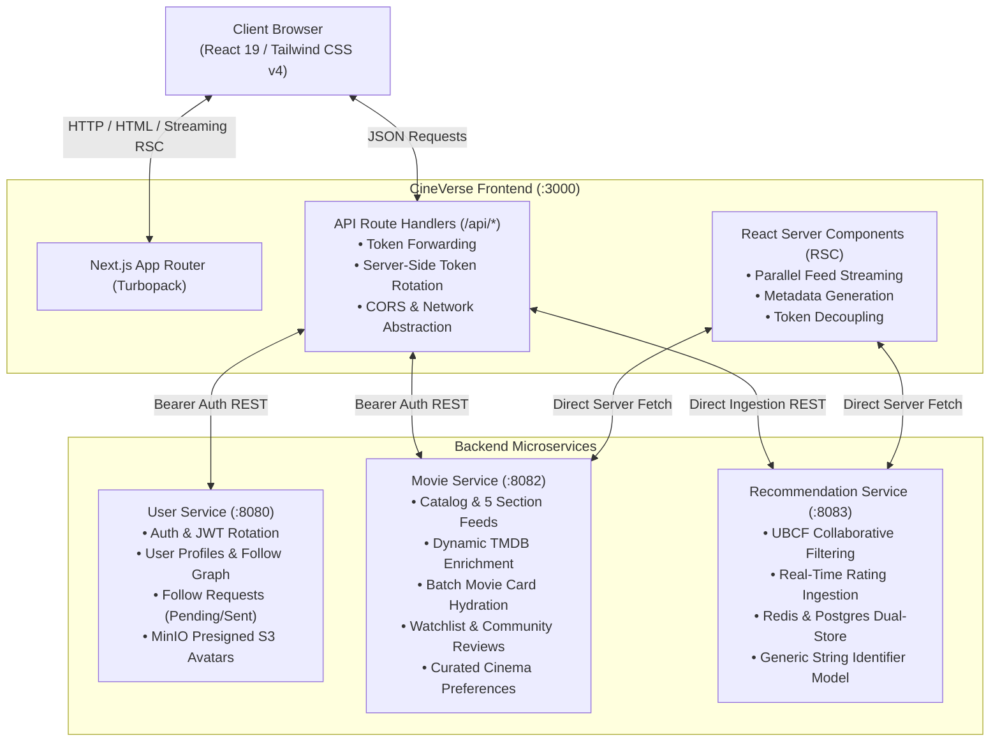
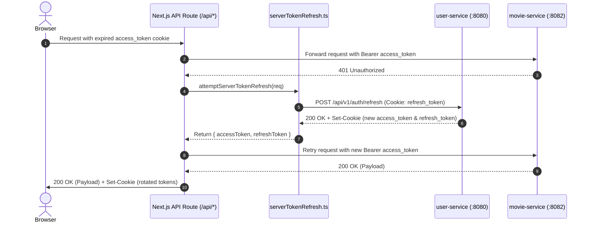
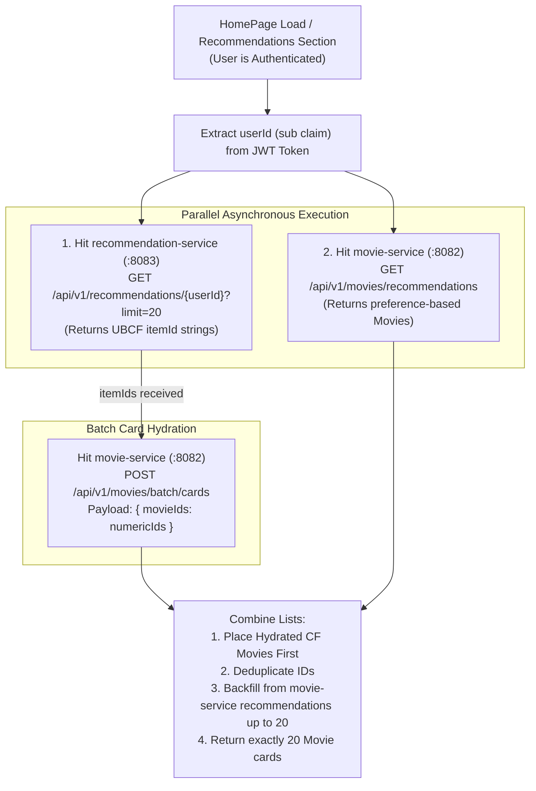
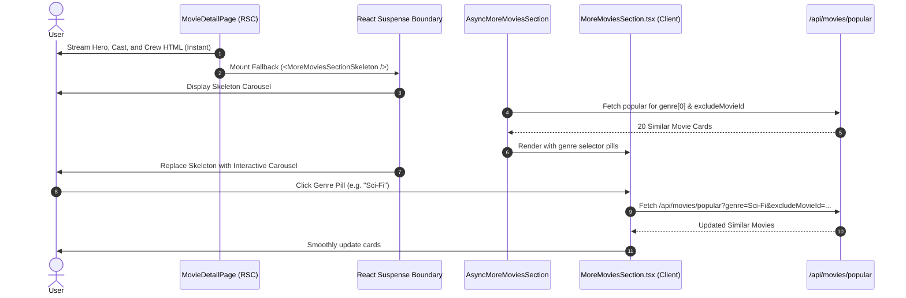
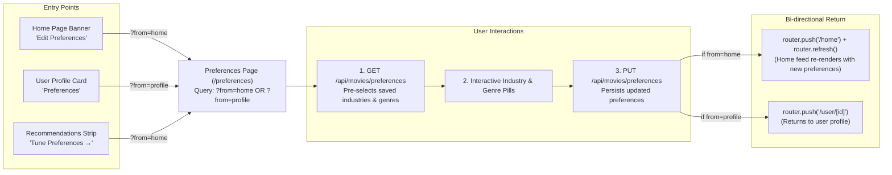

# 🎬 CineVerse Web Frontend — System Context & Engineering Architecture

This document serves as the **definitive technical specification and architectural manual** for the **CineVerse Web Frontend** application. It captures the architecture, domain models, microservice integration patterns, state management strategies, security flows, and operational blueprints for frontend engineers, backend engineers, and AI agents.

---

## 📑 Table of Contents
1. [System Landscape & Microservice Topology](#1-system-landscape--microservice-topology)
2. [Application Architecture & Tech Stack](#2-application-architecture--tech-stack)
3. [Authentication, Security & Token Lifecycle](#3-authentication-security--token-lifecycle)
4. [Hybrid Recommendation Engine (20-Movie Workflow)](#4-hybrid-recommendation-engine-20-movie-workflow)
5. [Movie Details, Lazy Similar Movies & Review Engine](#5-movie-details-lazy-similar-movies--review-engine)
6. [Cinema Preferences & Curated Feed Experience](#6-cinema-preferences--curated-feed-experience)
7. [Watchlist & Social Graph Synchronization](#7-watchlist--social-graph-synchronization)
8. [Complete API Route Proxy Registry](#8-complete-api-route-proxy-registry)
9. [Performance, SSR Streaming & Resilience Strategies](#9-performance-ssr-streaming--resilience-strategies)

---

## 1. System Landscape & Microservice Topology

The CineVerse Web Frontend is built with **Next.js 16+ App Router** and **React 19**, serving as the presentation layer and edge BFF (Backend-for-Frontend) orchestrator for the CineVerse microservice ecosystem.



### Microservice Ecosystem Matrix

| Service | Port | Base URL Config | Key Responsibilities |
| :--- | :--- | :--- | :--- |
| **`movie-frontend`** | `3000` | — | Server-side rendering (SSR), streaming Suspense boundaries, client interactivity, optimistic state mutations, and API route proxying. |
| **`user-service`** | `8080` | `NEXT_PUBLIC_USER_SERVICE_URL` | User registration, authentication, JWT generation and rotation, follower social graph, profile privacy, and S3/MinIO avatar presigned URLs. |
| **`movie-service`** | `8082` | `NEXT_PUBLIC_MOVIE_SERVICE_URL` | Catalog metadata, 5 home feed sections, popular similar movies, batch hydration (`/api/v1/movies/batch/cards`), watchlist CRUD, preferences, and platform reviews. |
| **`recommendation-service`** | `8083` | `NEXT_PUBLIC_RECOMMENDATION_SERVICE_URL` | Domain-agnostic collaborative filtering (UBCF), cosine similarity calculations, rating storage, and recommended item ID generation. |

---

## 2. Application Architecture & Tech Stack

### Technology Specifications
- **Framework**: Next.js 16.4.3 (App Router)
- **Runtime**: Node.js 20+ / React 19.3.0 / React DOM 19.3.0
- **Bundler & Build Tool**: Turbopack (`@tailwindcss/turbopack`)
- **Styling**: Tailwind CSS v4 (`@tailwindcss/turbopack`, CSS variables, dark-mode first)
- **Type Safety**: TypeScript 5+ (Strict mode, zero untyped API routes)

### Directory Structure & Layout
```
movie-frontend/
├── app/
│   ├── layout.tsx                     # Root HTML layout, font setup, AuthProvider, WatchlistProvider, Navbar
│   ├── globals.css                    # Tailwind CSS v4 styles & theme variables
│   ├── page.tsx                       # Root redirect (redirects to /home)
│   ├── home/
│   │   └── page.tsx                   # Streaming Home Feed (5 sections + Recommended For You)
│   ├── preferences/
│   │   └── page.tsx                   # Cinema Preferences selector with bi-directional navigation
│   ├── movie/
│   │   └── [id]/
│   │       └── page.tsx               # Movie Details, Cast/Crew, Lazy Similar Movies, Reviews
│   ├── cast/[id]/page.tsx             # Actor profile and filmography
│   ├── crew/[id]/page.tsx             # Crew profile and credited department works
│   ├── user/
│   │   ├── [id]/page.tsx              # User profile, follower lists, user reviews, watchlist
│   │   └── requests/
│   │       ├── pending/page.tsx       # Incoming follow requests management
│   │       └── sent/page.tsx          # Outgoing sent follow requests tracking
│   ├── watchlist/
│   │   └── page.tsx                   # Full-page paginated personal watchlist
│   ├── login/page.tsx                 # Authentication sign-in portal
│   ├── register/page.tsx              # New user sign-up portal
│   └── api/                           # Next.js BFF Route Handlers (Edge API proxies)
│       ├── auth/                      # Login, Register, Logout, Token Refresh
│       ├── recommendations/           # Recommendation fetch & rating sync proxies
│       ├── movies/                    # Preferences, recommendations, search, popular, watchlist, reviews
│       └── users/                     # Profile, search, follows, followers, reviews, avatar presigned
├── components/
│   ├── Navbar.tsx                     # Navigation header, real-time watchlist count, profile pill
│   ├── MovieCard.tsx                  # Standard movie poster card with hover rating & watchlist toggle
│   ├── MovieSection.tsx               # Horizontal scrolling carousel for movie sections
│   ├── MovieSectionSkeleton.tsx       # Animated pulse skeleton for feed sections
│   ├── MoreMoviesSection.tsx          # "More Movies Like This" with dynamic genre switcher pills
│   ├── MovieReviewsSection.tsx        # 5-star rating submission, multi-mode sorting, verified reviews
│   ├── UserReviewsSection.tsx         # User profile reviews feed with edit/delete modal
│   ├── WatchlistDetailButton.tsx      # Large action button for Movie Detail hero banner
│   ├── FollowRequestsHeader.tsx       # Tab navigation for Pending vs Sent requests
│   ├── CastCard.tsx                   # Cast member photo and character badge
│   ├── CrewCard.tsx                   # Key crew member avatar and deduplicated job badges
│   ├── SearchPersonCard.tsx           # Cast/crew result card in multi-search
│   └── HomeSearch.tsx                 # Universal multi-search bar (Movies, Actors, Crew)
├── context/
│   ├── AuthContext.tsx                # Client session state, current user, token, login/logout
│   └── WatchlistContext.tsx           # Optimistic watchlist cache, instant ID Set, count sync
├── services/
│   ├── apiClient.ts                   # Universal fetch wrapper with client-side token rotation
│   ├── serverTokenRefresh.ts          # Server-side token refresh mutex and cookie update helper
│   ├── movieService.ts                # Catalog, feeds, batch cards, watchlist, reviews, similar movies
│   ├── userService.ts                 # Profiles, avatar S3 upload, follow/unfollow, follower removal
│   └── recommendationService.ts       # Direct UBCF recommendations and rating submission client
└── types/
    ├── auth.ts                        # User, AuthState, FollowStatus, FollowRequest contracts
    └── movie.ts                       # Movie, MovieDetail, Cast, Crew, Review, SectionResponse
```

---

## 3. Authentication, Security & Token Lifecycle

### Token Storage Strategy
1. **HTTP-Only Cookies**:
   - `access_token` (Short-lived JWT, 15m - 24h depending on user-service policy)
   - `refresh_token` (Long-lived session token, 7d)
   - Stored with `HttpOnly: true`, `SameSite: Lax`, `Path: /`.
2. **Local Storage Fallback**:
   - Stored in browser `localStorage.getItem("cineverse_token")` for instant client-side hydration.

### Token Resolution Strategy (`resolveToken`)
Tokens are resolved in order of precedence:
```ts
1. Explicit parameter passed to function (e.g. token)
2. Server Environment: cookies().get("access_token") via next/headers
3. Browser Environment: localStorage.getItem("cineverse_token")
4. Browser Document Cookie: document.cookie parser for access_token
```

### Server-Side Single-Flight Token Rotation (`serverTokenRefresh.ts`)
When an SSR or API route encounters a `401 Unauthorized`:
1. It extracts the incoming `refresh_token` cookie.
2. Calls `user-service` at `POST /api/v1/auth/refresh`.
3. Reads the newly issued `Set-Cookie` headers for rotated `access_token` and `refresh_token`.
4. Re-applies the updated cookies to the outgoing `NextResponse` via `applyRotatedCookies()`.
5. Retries the original backend request with the new `access_token`.



---

## 4. Hybrid Recommendation Engine (20-Movie Workflow)

To deliver high-precision personalized discovery while eliminating cold-start latency, the application implements a **Hybrid 20-Movie Discovery Engine**.

### Architecture Workflow


### Step-by-Step Execution Details
1. **Parallel Invocations**:
   - `fetchDirectRecommendations(userId, 20)` targets `recommendation-service:8083`.
   - `fetchMovieServiceRecommendations()` targets `movie-service:8082`.
2. **Collaborative Filtering Hydration**:
   - The item IDs (e.g. `["1011985", "550", "27205"]`) returned by `recommendation-service` are mapped to integers.
   - Dispatches a single batch request to `movie-service`: `POST /api/v1/movies/batch/cards`.
   - Results are indexed in a hash map to preserve the exact ranking order determined by the collaborative filtering algorithm.
3. **Deficit Backfill & Deduplication**:
   - If `recommendation-service` returns fewer than 20 items (or on new account cold start):
   - Items from `movie-service`'s preference-based recommendations are appended.
   - An `existingIds` `Set<number>` ensures no duplicate movies appear.
   - The final array is sliced to `TARGET_COUNT = 20`.
4. **Rating Feedback Synchronization**:
   - Whenever a user rates or reviews a movie on the frontend, `submitRatingToRecommendationService()` dispatches a rating update event (`userId`, `itemId`, `rating`) to `recommendation-service:8083` via `POST /api/recommendations/ratings`.
   - Triggers on-demand recalculation of user similarity vectors.

---

## 5. Movie Details, Lazy Similar Movies & Review Engine

### Route: `/movie/[id]`

#### 1. Page Composition & SEO
- Dynamic metadata generation via `generateMetadata()`: Fetches title, year, and overview for OpenGraph and browser tab.
- Hero backdrop and poster with responsive blur fallback.
- Tagline, genres, runtime formatting (`2h 19m`), release date, and original language.
- Cast carousel with character badges.
- Key Crew carousel with **grouped roles** (deduplicates crew members holding multiple positions, e.g., "Director, Screenplay").

#### 2. Lazy "More Movies Like This" (`AsyncMoreMoviesSection`)
- **Non-blocking SSR**: Does not block initial page rendering. Wrapped in React `<Suspense fallback={<MoreMoviesSectionSkeleton />}>`.
- **Backend API**: `GET /api/v1/movies/popular?industry={industry}&genre={genre}&excludeMovieId={id}` (proxied via `/api/movies/popular`).
- **Interactive Genre Pills**: Allows the user to switch dynamically between any of the current movie's genres without a full-page reload.



#### 3. CineVerse Platform Ratings & Reviews (`MovieReviewsSection`)
- **Access Gate**: If the user is unauthenticated, prompts with a "Sign In to Access CineVerse Ratings & Reviews" card.
- **Platform Rating Overview**: Displays verified community average (0.0 to 5.0 stars) and total rating count.
- **User's Personal Review**:
  - Interactive 5-star rating selector with hover preview.
  - Review text input with character counters.
  - Edit and Delete capabilities for the review owner.
- **Community Reviews Feed**:
  - **Multi-Mode Sorting**:
    - `latest` (Default: newest reviews first)
    - `top` (Highest rated: 5-star to 1-star)
    - `low` (Lowest rated: 1-star to 5-star)
  - **User Hydration**: Resolves reviewer names and avatars via `GET /api/users?ids=uuid1,uuid2` (literal comma-separated list matching Spring Boot `@RequestParam List<UUID>`).
  - **Avatar Resilience**: `ReviewUserAvatar` utilizes native `` with SVG initials fallback to bypass local network / MinIO URL restrictions.

---

## 6. Cinema Preferences & Curated Feed Experience

### Route: `/preferences`

The preferences engine empowers users to curate their entertainment feed by choosing preferred cinema industries and genres.



### Supported Cinema Industries
- `HOLLYWOOD` (English - `en`)
- `TOLLYWOOD` (Telugu - `te`)
- `BOLLYWOOD` (Hindi - `hi`)
- `MOLLYWOOD` (Malayalam - `ml`)
- `KOLLYWOOD` (Tamil - `ta`)

### Supported Core Genres
`ACTION`, `ADVENTURE`, `THRILLER`, `HORROR`, `DRAMA`, `COMEDY`, `CRIME`, `DOCUMENTARY`, `FAMILY`, `ROMANCE`, `SCIENCE_FICTION`.

### Privacy Enforcement
- Preference controls are strictly restricted to the profile owner (`isOwner === true`).
- For other users' profiles, the preferences button and preference configuration details are completely hidden.

---

## 7. Watchlist & Social Graph Synchronization

### Global Watchlist State (`WatchlistContext.tsx`)
1. **Instant ID Set (`watchlistIds`)**:
   - Fetches lightweight ID array `GET /api/v1/movies/watchlist/ids` (< 2ms) upon login.
   - Provides $O(1)$ membership checks: `isInWatchlist(movieId)`.
2. **Optimistic Updates**:
   - Immediately adds or removes movie ID from the local `Set` and increments/decrements `totalElements`.
   - Dispatches background network request (`POST /api/movies/[id]/watchlist` or `DELETE /api/movies/[id]/watchlist`).
   - Automatically rolls back state if the network call fails.
3. **Navbar Counter**:
   - Synchronizes real-time watchlist badge in `Navbar.tsx` across all pages.

### Social Graph & Profile Management (`/user/[id]`)
- **Responsive Profile Header**: Uses `flex-col xl:flex-row`, `min-w-0` on container, and wrap controls to prevent button overflow across mobile, tablet, and desktop viewports.
- **Followers & Following Dropdowns**:
  - Live follower counts.
  - Interactive modal listing followers and following.
- **Follower Removal Provision**:
  - Profile owners can remove unwanted followers directly from their followers modal via `DELETE /api/users/followers/[id]`.
- **Profile Privacy**:
  - Supports `isPrivate` accounts. If private, watchlist and reviews are locked unless the viewer is an accepted follower.
- **Presigned Avatar Uploads**:
  - Requests presigned S3/MinIO upload URL via `POST /api/users/me/avatar/presigned-url`.
  - Performs direct binary upload to S3/MinIO.
  - Commits updated image URL via `PATCH /api/users/me`.

---

## 8. Complete API Route Proxy Registry

All backend interactions are routed through Next.js Route Handlers to eliminate CORS issues, manage secure cookies, and handle token rotation.

| Route Handler | Method | Proxied Microservice Endpoint | Description |
| :--- | :--- | :--- | :--- |
| **`/api/auth/login`** | `POST` | `user-service:8080/api/v1/auth/login` | Authenticates user; sets HttpOnly `access_token` and `refresh_token` cookies. |
| **`/api/auth/register`** | `POST` | `user-service:8080/api/v1/auth/register` | Registers new user account. |
| **`/api/auth/refresh`** | `POST` | `user-service:8080/api/v1/auth/refresh` | Rotates access and refresh tokens. |
| **`/api/auth/logout`** | `POST` | `user-service:8080/api/v1/auth/logout` | Revokes session; clears cookies. |
| **`/api/movies/preferences`** | `GET`, `PUT`| `movie-service:8082/api/v1/movies/preferences/me` | Fetches and updates user cinema preferences. |
| **`/api/movies/recommendations`** | `GET` | `movie-service:8082/api/v1/movies/recommendations` | Fetches preference-based movie recommendations. |
| **`/api/movies/popular`** | `GET` | `movie-service:8082/api/v1/movies/popular` | Fetches popular movies by industry/genre excluding current ID. |
| **`/api/movies/search`** | `GET` | `movie-service:8082/api/v1/movies/search` | Unified multi-search across movies, actors, and crew. |
| **`/api/movies/watchlist`** | `GET` | `movie-service:8082/api/v1/movies/watchlist/me` | Paginated watchlist retrieval for current user. |
| **`/api/movies/watchlist/ids`** | `GET` | `movie-service:8082/api/v1/movies/watchlist/ids` | Fast numeric IDs list of all watchlisted movies. |
| **`/api/movies/[id]/watchlist`** | `POST`, `DELETE`| `movie-service:8082/api/v1/movies/{id}/watchlist` | Add or remove movie from watchlist. |
| **`/api/movies/[id]/reviews`** | `GET`, `POST`| `movie-service:8082/api/v1/movies/{id}/reviews` | Fetch community reviews or submit a new review. |
| **`/api/movies/[id]/reviews/me`** | `GET`, `DELETE`| `movie-service:8082/api/v1/movies/{id}/reviews/me` | Fetch or delete current user's review for a movie. |
| **`/api/recommendations/[userId]`**| `GET` | `recommendation-service:8083/api/v1/recommendations/{userId}` | Direct collaborative filtering recommendation item IDs. |
| **`/api/recommendations/ratings`** | `POST` | `recommendation-service:8083/api/v1/ratings` | Ingests user ratings into recommendation engine. |
| **`/api/users`** | `GET` | `user-service:8080/api/v1/users?ids=...` | Batch resolves user profiles by UUID list. |
| **`/api/users/me`** | `GET`, `PATCH`| `user-service:8080/api/v1/users/me` | Fetch and update current user profile details. |
| **`/api/users/search`** | `GET` | `user-service:8080/api/v1/users/search` | Debounced user search by username/email. |
| **`/api/users/[id]`** | `GET` | `user-service:8080/api/v1/users/{id}` | Fetch public or follower-accessible user profile. |
| **`/api/users/[id]/follow`** | `POST`, `DELETE`| `user-service:8080/api/v1/users/{id}/follow` | Send follow request or unfollow user. |
| **`/api/users/[id]/follow-status`**| `GET` | `user-service:8080/api/v1/users/{id}/follow-status` | Check follow relationship status. |
| **`/api/users/[id]/followers`** | `GET` | `user-service:8080/api/v1/users/{id}/followers` | List user followers. |
| **`/api/users/[id]/following`** | `GET` | `user-service:8080/api/v1/users/{id}/following` | List users followed by profile. |
| **`/api/users/followers/[id]`** | `DELETE` | `user-service:8080/api/v1/users/followers/{id}` | Remove a follower from user's followers list. |

---

## 9. Performance, SSR Streaming & Resilience Strategies

### 1. Parallel Streaming with Suspense Boundaries
- The Home page (`app/home/page.tsx`) renders the search bar and welcome banner instantly.
- Each movie section (`Trending Today`, `Trending This Week`, `All-Time Popular`, `Top Rated`, `Now Playing`, and `Recommended For You`) runs inside its own `<Suspense fallback={<MovieSectionSkeleton />}>`.
- Sections stream directly to the browser as soon as their respective backend cache or TMDB fetch resolves.

### 2. Local IP & SSRF Handling for MinIO Avatars
- Next.js default image optimization restricts local and private network hostnames (SSRF prevention).
- In `next.config.ts`, `images.dangerouslyAllowLocalIP = true` is enabled to allow local S3/MinIO instances (`http://localhost:4566`, `http://127.0.0.1:4566`).
- `ReviewUserAvatar` provides native image fallback with SVG initials to guarantee zero broken image badges.

### 3. Query Parameter String Encoding Optimization
- Spring Boot `@RequestParam List<UUID>` requires standard comma-delimited strings (`?ids=id1,id2`).
- Frontend fetchers pass literal comma-separated strings rather than URL-encoded `%2C` to prevent HTTP 400 Bad Request parsing errors.

### 4. Single-Flight Mutex Token Rotation
- Concurrent API requests hitting expired JWTs share a single refresh attempt rather than bombarding `user-service` with parallel refresh requests.
- Cookie state is synchronized back to the client browser in the response stream.

---

## 10. Operational Guidelines & Verification

### Running the Development Environment
```bash
# 1. Install dependencies
npm install

# 2. Run Turbopack development server
npm run dev
# App listens on http://localhost:3000

# 3. Type-check verification
npx tsc --noEmit

# 4. Production build
npm run build
```

### Environment Configuration (`.env.local`)
```env
NEXT_PUBLIC_USER_SERVICE_URL=http://localhost:8080
NEXT_PUBLIC_MOVIE_SERVICE_URL=http://localhost:8082
NEXT_PUBLIC_RECOMMENDATION_SERVICE_URL=http://localhost:8083
```

